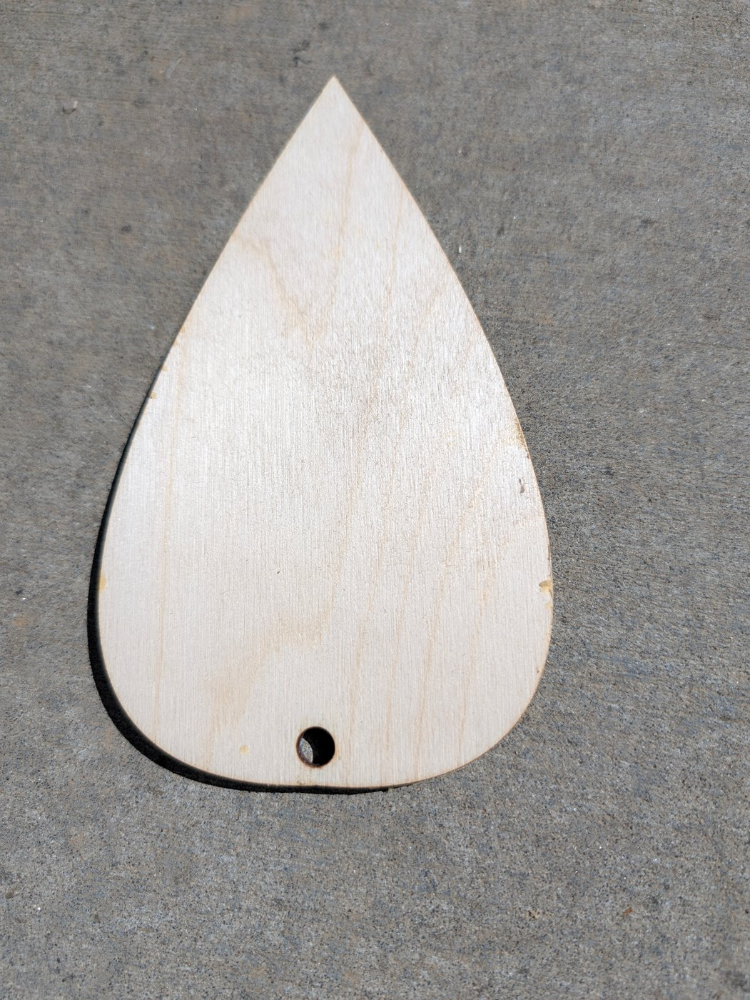
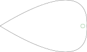
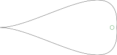
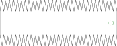

# Bullroarer — five blade profiles

**[← All projects](https://gernreich.github.io/)**

**[Read the README](https://github.com/Gernreich/bullroarer)**

**[Turn it in 3D](https://gernreich.github.io/bullroarer/bullroarer-3d.html)**

<iframe src="bullroarer-3d.html?embed" title="The bullroarer blades as solid parts you can drag to turn, each its cut file's own outline with the cord tied through its hole, with a button for each blade and a box to spin it" style="width:100%;height:560px;border:0"></iframe>

> **This is a dangerous object. It can injure you, and it can injure anyone
> near you.** A bullroarer is a weight on the end of a string and behaves like
> one: 17g in a single 3 mm thickness and 51g laminated three times, travelling
> on the order of 10 to 20 metres per second at the end of a line you cannot
> stop quickly. Three of these five profiles come to a point and the sawtooth
> carries teeth down both long edges. Swing it outdoors, in a clear circle
> several metres across, with nobody inside that circle — and read
> [Handle it with care](#handle-it-with-care) before you swing it at all.

A bullroarer is a flat blade on a cord. Whirled overhead, it spins about its own
long axis while it circles, and the alternating faces chop the air into a pulsing
roar. The pitch follows how fast you swing it; the shape of the blade decides how
readily it spins and how much of the sound is roar rather than whistle.

Five profiles, all cut-ready. They differ only in outline — every one is a single
closed cut with one 7 mm cord hole.

**One of them is cut.** The convex tapered blade, cut twice and glued face to face — two
laminations, 6 mm thick:

<p align="center"></p>

## Get the files

- **[Everything as a ZIP](https://github.com/Gernreich/bullroarer/archive/refs/heads/main.zip)**
  — all five profiles.
- **[Repository](https://github.com/Gernreich/bullroarer)** — if you want to change
  a profile or read the geometry.
- Or click any picture below to download that one cut file.

Released under CC0 1.0 — do what you like with them, no attribution needed. Built for
**[LaserMadeMusic](https://www.youtube.com/@LaserMadeMusic)**.

**[The rest of the build files](https://gernreich.github.io/lasermademusic.html)** — every instrument,
generator and tool, indexed.

## The five profiles

Click any of these to download the cut file. The pictures are display renderings —
the cut files draw a hairline on no background at all, which a browser shows almost
invisibly, so these are thickened and painted onto a light ground and cropped to the
part. Green, orange and cyan are darkened in the picture — at full strength they are too pale to read against a light ground. The cut file keeps the exact values. **Each is shown at its own scale**, so the sizes below are the ones that matter,
not how large the picture looks.

<div class="tw">
<table>
<tr>
<td align="center"><a href="BullroarerRectangular.svg"></a></td>
<td align="center"><a href="BullroarerConvexNarrowTapered.svg"></a></td>
<td align="center"><a href="BullroarerConvexTapered.svg"></a></td>
</tr>
<tr>
<td align="center"><sub>Rectangular · 200 × 42 mm</sub></td>
<td align="center"><sub>Convex narrow tapered · 204 × 33 mm</sub></td>
<td align="center"><sub>Convex tapered · 151 × 89 mm</sub></td>
</tr>
<tr>
<td align="center"><a href="BullroarerConcaveTapered.svg"></a></td>
<td align="center"><a href="BullroarerSawtooth.svg"></a></td>
<td></td>
</tr>
<tr>
<td align="center"><sub>Concave tapered · 200 × 95 mm</sub></td>
<td align="center"><sub>Sawtooth · 169 × 68 mm</sub></td>
<td></td>
</tr>
</table>
</div>

## What the files contain

Drawn by `bullroarer.rs` from each blade's parameters (by hand in Inkscape until
2026-11-08; the defaults are the drawn blades):

| Profile | Blade | Cord hole | Hole centre |
|---|---|---|---|
| `BullroarerRectangular.svg` | 200.0 × 42.1 mm | 7 mm | 10.6 mm from the near end |
| `BullroarerConvexNarrowTapered.svg` | 204.3 × 32.9 mm | 7 mm | 8.0 mm from the blunt end |
| `BullroarerConvexTapered.svg` | 150.5 × 89.3 mm | 7 mm | 7.3 mm from the round end |
| `BullroarerConcaveTapered.svg` | 200.3 × 94.6 mm | 7 mm | 8.5 mm from the round end |
| `BullroarerSawtooth.svg` | 169.2 × 67.6 mm | 7 mm | 8.8 mm from the near end |

**Every cord hole sits on the blade's long centreline.** That is not decoration: a hole
off the centreline makes the blade spin unevenly and the roar stutters.

Each file is cropped to the blade itself, so the sheet **is** the outline. Output is
millimetre-true — `1 user unit = 1 mm` with a physical `width`/`height` — so it prints
and cuts at real size.

### Colour is the cut order

**Colour is the cut order, and it is the same in every LaserMadeMusic repository: blue engraves, then green → orange → cyan → black.** Black is always the last cut, the one that frees the part; violet means skip and is never cut. A file uses only the stages it needs. There is no engrave layer here, and only two of
the four cut stages are used.

| | Colour | What | Why then |
|---|---|---|---|
| 1 | **green `#00ff00`** | the cord hole | while the blade is still whole |
| 2 | **black `#000000`** | the outline | frees the blade, so it goes last |

Give both an explicit operation. A per-colour job silently skips any colour you leave
unmapped — leave green out and you get a blade with nothing to hang it on.

## Before you cut

**Cut these in 3 mm Baltic birch plywood** — that is what they are built in. It matters
more than the profile does: a bullroarer has to survive being whirled hard on a cord, and
the blade is the part that fails. Ply can delaminate and a knot can split out through the
cord hole, so run the face grain along the blade rather than across it. Baltic birch earns
its place here for its void-free core; a cheaper ply with voids is a weak blade waiting to
find them.

**Two or more laminations may be needed for the best sound.** Cut the same profile twice
or three times and glue the copies face to face. A single 3 mm blade is light, and a
bullroarer's note comes from a blade with enough mass to keep spinning against the air
rather than being pushed about by it — thicker gives a fuller roar and a steadier one.
It also puts more material around the cord hole, which is where a single sheet tears
out. Line the holes up when you glue, and keep the laminate symmetric about the
centreline so the blade still spins true.

**The cord is not in these files.** Neither is any advice on it, because the right cord
is a function of your blade's mass and how hard you intend to swing. A swivel between
cord and blade is worth considering: without one the cord twists up as the blade spins.

## Handle it with care

**A bullroarer is a weight on the end of a string, and it behaves like one.** Mass, speed
and shape all work against you here, and the lamination advice above makes the first of
them worse — that is the trade you are making for a better sound.

**Mass.** The plain rectangular blade is about **17g** in a single 3 mm thickness, **34g**
laminated twice and **51g** three times (Baltic birch at roughly 680 kg/m³). The larger
profiles are heavier again. That is a small stone, and it is travelling.

**Speed.** On a metre of cord at two or three turns a second, the blade is moving on the
order of **10 to 20 metres per second** — cyclist's pace, at the end of a line you cannot
stop quickly. The cord stores that energy and gives it all back if the blade catches
something.

**Shape.** Three of the five profiles come to a point, and the sawtooth has a row of
teeth down both long edges. A spinning edge does not need to be sharp to cut, and these
are not blunt.

So: **swing it outdoors, in a clear circle several metres across, with nobody inside that
circle.** Check the cord and the knot before every session — the cord hole is where a
blade fails, and it fails at full speed. Wear eye protection while you are learning how
far it actually reaches. It is loud on purpose, so mind ears as well as heads.

## Files

| | |
|---|---|
| `Bullroarer*.svg` | the five cut-ready profiles |
| `previews/` | display renderings — **not** cut files |
| `photos/` | the build so far, photographed |
| `bullroarer-3d.html` | the 3D view, assembled from the cut files — drag to turn |
| `bullroarer.rs` | draws the five cut files and writes the SolidCraft designs from each blade's parameters (Changing it, below) |
| `solidcraft/` · `step/` | the SolidCraft designs and the STEP files built from them |
| `viewer.rs` | builds `bullroarer-3d.html` from the cut files, with the turn3d module in lasermade-tools: `cargo build --release`, then `target/release/viewer` |
| `Cargo.toml` · `Cargo.lock` | the Rust package for `bullroarer.rs` and `viewer.rs`; it expects the lasermade-tools checkout beside this one |
| `.repro` | how every shipped drawing and page is reproduced |
| `index.md` · `index.html` | this page; the markdown is the source |

## Changing it

Every blade is a few numbers, and each is a flag on `bullroarer.rs` (with `--blade=NAME`,
since each blade has its own; a dash for each underscore) and a parameter of the same
name in that blade's SolidCraft design:

```
cargo build --release
target/release/bullroarer --blade=sawtooth --teeth=24 --depth=14
```

Without `--blade` it redraws all five at their defaults. Each run prints the blade's
size, its mass a lamination and the ply round the cord hole, and a validation block:
the hole on the centreline, at least 3 mm of ply round it, the outline a blade, and the
bed. `--out=DIR` writes elsewhere; `--no-write` only checks.

The curved blades are cubic Béziers, as they were drawn. A Bézier blade's `width` is
exact: the control points' heights are scaled so the curve's widest point is `width`,
the ratio between the two heights fixed as drawn, and their places along the blade are
fractions of its length. The defaults are the drawn blades, to a ten-thousandth of a
millimetre.

**rectangular**

| parameter | default | what it is |
|---|---|---|
| `ply` | 3 mm | the ply: one lamination |
| `laminations` | 1 | blades glued face to face: the design's thickness is laminations × ply |
| `length` | 200 mm | the blade, end to end |
| `width` | 42.127 mm | the blade, across |
| `hole_d` | 7 mm | the cord hole |
| `hole_inset` | 10.5833 mm | the cord hole's centre from the near end |

**convex-tapered**

| parameter | default | what it is |
|---|---|---|
| `ply` | 3 mm | the ply: one lamination |
| `laminations` | 1 | blades glued face to face: the design's thickness is laminations × ply |
| `length` | 150.3666 mm | point to round end, along the centreline |
| `width` | 89.3231 mm | the blade at its widest |
| `c1_x` | 0.6535 | the first control point, along: a fraction of the length |
| `c2_x` | 1.0236 | the second control point, along: past 1 rounds the end |
| `hole_d` | 7 mm | the cord hole |
| `hole_inset` | 7.1665 mm | the cord hole's centre from the round end |

**concave-tapered**

| parameter | default | what it is |
|---|---|---|
| `ply` | 3 mm | the ply: one lamination |
| `laminations` | 1 | blades glued face to face: the design's thickness is laminations × ply |
| `length` | 200 mm | point to round end, along the centreline |
| `width` | 94.5916 mm | the blade at its widest |
| `c1_x` | 0.3333 | the first control point, along: a fraction of the length |
| `c2_x` | 1.0391 | the second control point, along: past 1 rounds the end |
| `hole_d` | 7 mm | the cord hole |
| `hole_inset` | 8.143 mm | the cord hole's centre from the round end |

**convex-narrow-tapered**

| parameter | default | what it is |
|---|---|---|
| `ply` | 3 mm | the ply: one lamination |
| `laminations` | 1 | blades glued face to face: the design's thickness is laminations × ply |
| `length` | 204.2912 mm | blunt end to point |
| `end_w` | 29.7277 mm | the blunt end, across: where the Béziers start |
| `cap` | 3.2839 mm | the blunt end's half-ellipse, deep |
| `belly_x` | 0.5246 | the control point, along the curve's run: a fraction |
| `belly` | 7.5933 mm | the control point, out beyond the blunt end's width |
| `hole_d` | 7 mm | the cord hole |
| `hole_inset` | 7.9702 mm | the cord hole's centre from the blunt end |

**sawtooth**

| parameter | default | what it is |
|---|---|---|
| `ply` | 3 mm | the ply: one lamination |
| `laminations` | 1 | blades glued face to face: the design's thickness is laminations × ply |
| `length` | 169.2231 mm | the blade, end to end |
| `teeth` | 30 | teeth down each edge |
| `core` | 34.4578 mm | the blade between the teeth's roots |
| `depth` | 16.5922 mm | a tooth, root to tip |
| `lean` | 0.4485 | a tooth's tip along its pitch, from the end it starts at |
| `hole_d` | 7 mm | the cord hole |
| `hole_inset` | 8.7918 mm | the cord hole's centre from the near end |

## SolidCraft designs and STEP files

`solidcraft/bullroarer-NAME.solidcraft.json` is each blade as a parametric SolidCraft
design, written by

```
target/release/bullroarer --no-write --solidcraft=solidcraft
```

and SolidCraft builds each design file and STEP file from it:

```
cd solidcraft
solidcraft-cli run bullroarer-sawtooth.solidcraft.json --save bullroarer-sawtooth.sc --out ../step/bullroarer-sawtooth.step --quiet
../../lasermade-tools/target/release/sc-slim bullroarer-sawtooth.sc
```

Each is one body, `laminations` × `ply` thick: the two or three blades glued face to
face that [Before you cut](#before-you-cut) recommends are one part here. The curves are drawn from their
formulas, so they follow every parameter, and the sawtooth's teeth are a pattern
counted by its `teeth` parameter. Built, each blade's volume matches the generator's to
within 3e-5 (SolidCraft fits the curves to 0.001 mm), and with four to six parameters
of each blade moved at once, the design builds what the generator draws at those
values. `.repro` checks all fifteen files. The STEP files used to be written from the
3D view by `step-export`; since 2026-11-08 SolidCraft builds them.

The files:

- `solidcraft/bullroarer-rectangular.solidcraft.json` · `solidcraft/bullroarer-rectangular.sc` · `step/bullroarer-rectangular.step`
- `solidcraft/bullroarer-convex-tapered.solidcraft.json` · `solidcraft/bullroarer-convex-tapered.sc` · `step/bullroarer-convex-tapered.step`
- `solidcraft/bullroarer-concave-tapered.solidcraft.json` · `solidcraft/bullroarer-concave-tapered.sc` · `step/bullroarer-concave-tapered.step`
- `solidcraft/bullroarer-convex-narrow-tapered.solidcraft.json` · `solidcraft/bullroarer-convex-narrow-tapered.sc` · `step/bullroarer-convex-narrow-tapered.step`
- `solidcraft/bullroarer-sawtooth.solidcraft.json` · `solidcraft/bullroarer-sawtooth.sc` · `step/bullroarer-sawtooth.step`

## Credits

Made by Michael Gernreich with [Claude](https://www.anthropic.com/claude) (Anthropic), working in Claude Code, which co-wrote the code and the documentation. Commits Claude made carry a `Co-Authored-By: Claude` line.
